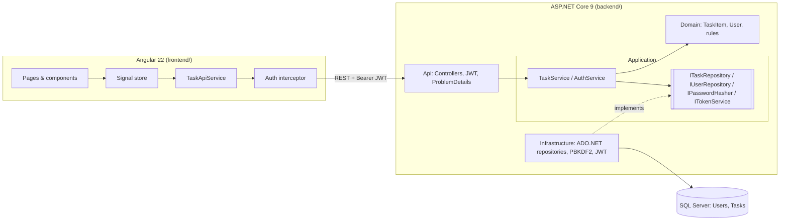

# Task Manager: Ballast Lane .NET Technical Exercise

A full-stack task management application: **ASP.NET Core 9 Web API** (Clean Architecture, TDD, raw ADO.NET on **SQL Server**) and an **Angular 22** frontend.

> No Entity Framework, Dapper or MediatR, as the exercise requires. Data access is hand-written, parameterized ADO.NET (`Microsoft.Data.SqlClient`).

| Document | What's inside |
| --- | --- |
| [docs/PRESENTATION.md](docs/PRESENTATION.md) | Thought process, user story, design decisions, demo script, trade-offs |
| [docs/GENAI.md](docs/GENAI.md) | **Generative AI section**: prompts, output, validation, corrections, edge cases |
| [AGENTS.md](AGENTS.md) | Project rules given to the AI coding agent (Cursor) |

---

## User story

> **As a** busy professional,
> **I want to** create an account and keep a private list of tasks with a title, description, status and due date,
> **so that** I always know what is pending, what is in progress and what is overdue, and nobody else can see my tasks.

Acceptance criteria:

1. I can register with a username, email and password, and I'm signed in right away.
2. I can sign in and out. My session expires automatically.
3. I can create, view, edit and delete tasks. New tasks start as **Pending**.
4. A task needs a title (max 200), an optional description (max 2000) and a due date that is not in the past.
5. I can change a task's status quickly (Pending, In progress, Completed) and filter or search my list.
6. Overdue tasks are highlighted. An overdue task can still be edited or completed without changing its date.
7. I can never see or modify another user's tasks.
8. Errors are clear and shown next to the field that caused them.

---

## Quick start

### Prerequisites

| Tool | Version | Notes |
| --- | --- | --- |
| .NET SDK | 9.0+ | `dotnet --list-sdks` |
| Node.js | 20.19+ or 22.12+ | required by Angular 22 |
| SQL Server | LocalDB (ships with Visual Studio), Express, Developer or Docker | see [Using another SQL Server](#using-another-sql-server) |

### 1. Run the API

```bash
cd backend
dotnet run --project src/TaskManager.Api --launch-profile http
```

On first start (Development environment), the API:

1. creates the `TaskManager` database on `(localdb)\MSSQLLocalDB` if it does not exist,
2. applies the idempotent schema script [`001_CreateSchema.sql`](backend/src/TaskManager.Infrastructure/Persistence/Scripts/001_CreateSchema.sql),
3. seeds the demo users and tasks.

Swagger UI: **http://localhost:5080/swagger** (log in, copy `accessToken`, click **Authorize**).

### 2. Run the frontend

```bash
cd frontend
npm install
npm start
```

Open **http://localhost:4200**. The dev server proxies `/api` to the API ([`proxy.conf.json`](frontend/proxy.conf.json)), so no CORS setup is needed in development.

### Demo credentials

| Username | Password | Purpose |
| --- | --- | --- |
| `demo` | `Demo123!` | 5 seeded tasks in every status, including an overdue one |
| `jane` | `Jane123!` | Second account, to show that users can't see each other's tasks |

The login page has a **Use demo** button that fills these in.

### Using another SQL Server

Override the connection string with an environment variable (no code change):

```bash
# Docker (works on macOS/Linux too)
docker compose up -d
export ConnectionStrings__TaskManager="Server=localhost,1433;Database=TaskManager;User Id=sa;Password=Your_strong_Passw0rd;TrustServerCertificate=true"
```

---

## Tests

```bash
cd backend
dotnet test                       # 131 tests: unit + API + SQL integration

cd frontend
npm test -- --watch=false         # 44 tests (Vitest)
```

| Suite | Count | What it covers |
| --- | --- | --- |
| `TaskManager.UnitTests` / Domain | 37 | Entity invariants (title, description, due date, status, username, email) |
| `TaskManager.UnitTests` / Application | 32 | `TaskService` and `AuthService` with NSubstitute mocks and a `FakeTimeProvider` |
| `TaskManager.UnitTests` / Infrastructure | 11 | Password hashing, JWT issuing and validation |
| `TaskManager.UnitTests` / Architecture | 7 | Clean Architecture dependency rule; no EF, Dapper or MediatR |
| `TaskManager.IntegrationTests` / Api | 26 | Real HTTP pipeline (`WebApplicationFactory`): status codes, JWT, validation, **cross-user isolation** |
| `TaskManager.IntegrationTests` / Persistence | 18 | ADO.NET repositories and one end-to-end flow against a **real, throw-away SQL Server database** |
| Frontend (Vitest) | 44 | Auth service and interceptor, store, validators, date handling, components |

**Backend coverage: 86% of lines, 82% of branches.** To reproduce:

```bash
cd backend
dotnet test --collect:"XPlat Code Coverage" --results-directory TestResults
dotnet tool restore
dotnet reportgenerator -reports:"TestResults/**/coverage.cobertura.xml" -targetdir:"TestResults/report" -reporttypes:Html
```

The SQL tests create a database named `TaskManager_Tests_<guid>` and drop it at the end. If SQL Server is not reachable they are **skipped** rather than failed. Set `TASKMANAGER_TEST_SQL` to point them at another server.

**TDD:** the git history shows each layer's tests committed (red) before its implementation (green): `git log --oneline`.

---

## Architecture



**Dependency rule:** `Api → Application → Domain` and `Infrastructure → Application`. Domain and Application don't reference SQL, ASP.NET or any infrastructure package, and [`DependencyRuleTests`](backend/tests/TaskManager.UnitTests/Architecture/DependencyRuleTests.cs) fails the build if that changes.

| Layer | Project | Responsibility |
| --- | --- | --- |
| Domain | `TaskManager.Domain` | Entities with invariants (`TaskItem`, `User`), `DomainValidationException`. Zero dependencies. |
| Application | `TaskManager.Application` | Use cases (`TaskService`, `AuthService`), DTOs, password policy, ports (interfaces). |
| Infrastructure | `TaskManager.Infrastructure` | ADO.NET repositories, schema initializer, demo seeder, PBKDF2 hasher, JWT issuer. |
| API | `TaskManager.Api` | Controllers, authentication, error mapping to RFC 7807, rate limiting, Swagger. |

### Project structure

```
backend/
  src/
    TaskManager.Domain/            Tasks/TaskItem.cs, Users/User.cs, Common/
    TaskManager.Application/       Tasks/, Auth/, Abstractions/ (ports), Common/ (exceptions)
    TaskManager.Infrastructure/    Persistence/ (ADO.NET + Scripts/*.sql), Security/
    TaskManager.Api/               Controllers/, Infrastructure/ (auth, errors, swagger), Program.cs
  tests/
    TaskManager.UnitTests/         Domain/, Application/, Infrastructure/, Architecture/
    TaskManager.IntegrationTests/  Api/ (in-memory HTTP), Persistence/ (real SQL Server)
frontend/
  src/app/
    core/        auth (service, interceptor, guards), http (problem-details mapping)
    features/    auth (login, register), tasks (page, card, dialog, store, api)
    layout/      shell (toolbar)
    shared/      confirm dialog, date utils
docs/            PRESENTATION.md, GENAI.md
```

---

## API

All responses are JSON. Errors use [RFC 7807 Problem Details](https://www.rfc-editor.org/rfc/rfc7807), and validation errors are grouped by field.

### Users API (`/api/auth`)

| Verb | Route | Auth | Success | Errors |
| --- | --- | --- | --- | --- |
| `POST` | `/api/auth/register` | Public | `201` `AuthResponse` | `400` validation, `409` username/email taken, `429` |
| `POST` | `/api/auth/login` | Public | `200` `AuthResponse` | `400`, `401` invalid credentials, `429` |
| `GET` | `/api/auth/me` | **Bearer** | `200` `UserResponse` | `401` |
| `GET` | `/health` | Public | `200` | |

### Tasks API (`/api/tasks`, all routes require a Bearer token)

| Verb | Route | Body / Query | Success | Errors |
| --- | --- | --- | --- | --- |
| `GET` | `/api/tasks` | `?status=Pending\|InProgress\|Completed` (optional) | `200` `TaskResponse[]` ordered by due date | `401` |
| `GET` | `/api/tasks/{id}` | | `200` `TaskResponse` | `401`, `404` |
| `POST` | `/api/tasks` | `{ title, description?, dueDate }` | `201` + `Location` header | `400`, `401` |
| `PUT` | `/api/tasks/{id}` | `{ title, description?, status, dueDate }` | `200` `TaskResponse` | `400`, `401`, `404` |
| `DELETE` | `/api/tasks/{id}` | | `204` | `401`, `404` |

Example:

```http
POST /api/tasks
Authorization: Bearer eyJhbGciOi...
Content-Type: application/json

{ "title": "Prepare demo", "description": "Seed data", "dueDate": "2026-10-05" }
```

```json
{
  "id": "6f1c...", "title": "Prepare demo", "description": "Seed data",
  "status": "Pending", "dueDate": "2026-10-05", "isOverdue": false,
  "createdAtUtc": "2026-10-02T18:00:00Z", "updatedAtUtc": "2026-10-02T18:00:00Z"
}
```

### Database

```sql
Users (Id UNIQUEIDENTIFIER PK, Username NVARCHAR(50) UNIQUE CI, Email NVARCHAR(254) UNIQUE,
       PasswordHash NVARCHAR(512), CreatedAtUtc DATETIME2)
Tasks (Id UNIQUEIDENTIFIER PK NONCLUSTERED, UserId FK -> Users ON DELETE CASCADE,
       Title NVARCHAR(200), Description NVARCHAR(2000) NULL, Status TINYINT CHECK (0,1,2),
       DueDate DATE, CreatedAtUtc DATETIME2, UpdatedAtUtc DATETIME2)
       CLUSTERED INDEX (UserId, DueDate)
```

---

## Security and quality highlights

- **Passwords**: hashed with ASP.NET Core Identity's `PasswordHasher` (PBKDF2, HMAC-SHA512, salted). Plain passwords are never stored, logged or returned.
- **JWT**: HMAC-SHA256, issuer, audience and lifetime validated, signing key of at least 256 bits enforced at startup (`ValidateOnStart`).
- **Secure by default**: a fallback authorization policy requires authentication. Only `register`, `login` and `health` are `[AllowAnonymous]`.
- **No IDOR**: every query filters by `UserId` taken from the token. Another user's task returns `404`, not `403`.
- **No user enumeration**: "unknown user" and "wrong password" return the same message and take the same time.
- **SQL injection**: 100% parameterized SQL with explicit types and sizes, covered by tests that use injection payloads.
- **Rate limiting** on login and register (per IP), **CORS** allow-list, **HSTS** and HTTPS redirection outside Development.
- **Frontend**: the token is sent only to `/api/*`, the session ends on 401 or expiry, `returnUrl` can't be used as an open redirect, and the browser console is clean.
- `TreatWarningsAsErrors` plus .NET analyzers (`latest-recommended`), nullable reference types and `strict` TypeScript and templates.

## Configuration

| Key | Default | Description |
| --- | --- | --- |
| `ConnectionStrings:TaskManager` | LocalDB | SQL Server connection string |
| `Database:InitializeOnStartup` | `true` in Development | Create the database and schema if missing |
| `Database:SeedDemoData` | `true` in Development | Seed the demo users (idempotent) |
| `Jwt:SigningKey` | dev-only key in `appsettings.Development.json` | **Must** be supplied via environment or secret store outside Development |
| `Jwt:ExpirationMinutes` | `60` | Token lifetime |
| `Cors:AllowedOrigins` | `http://localhost:4200` | Allowed browser origins |
| `RateLimiting:AuthPermitLimit` | `10` per minute | Login and register attempts per IP |

## What I would add next

Pagination and server-side sorting, optimistic concurrency (`rowversion`) on updates, refresh tokens in httpOnly cookies, a real migrations tool (DbUp or grate), Docker images and a CI pipeline (GitHub Actions running both test suites), and Playwright E2E tests in CI.
